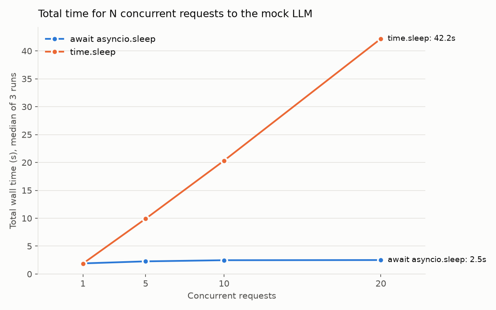

# Experiment 1: `asyncio.sleep` vs `time.sleep` in the mock LLM

[← Back to README](../../README.md) · [Stage 1: Mock LLM](../stage1-mock-llm.md)

## Why this test?

Calling an LLM is mostly **waiting**. A single call can take seconds, and almost all of that time
the server isn't doing any work. It's just waiting for the answer to come back.

There are two ways to wait inside an `async def` endpoint:

- **`time.sleep` (blocking):** the whole server freezes until the wait is over.
  Nobody else gets served. Requests line up and go one at a time.
- **`await asyncio.sleep` (non-blocking):** the request says "wake me up when it's my turn"
  and steps aside. The event loop serves other requests in the meantime.

That's the whole point of going async: **while one request waits, others can make progress.**

My mock LLM fakes model latency with a sleep. If it used the blocking kind, the mock itself would
become the bottleneck, and every load test after this would measure the mock instead of my backend.
So before building anything on top of it, I wanted to prove the mock can handle many requests at once.

## TL;DR



| Concurrent requests | `await asyncio.sleep` | `time.sleep` | How much slower |
|---|---|---|---|
| 1 | 1.90 s | 1.87 s | 1.0× |
| 5 | 2.27 s | 9.91 s | 4.4× |
| 10 | 2.47 s | 20.33 s | 8.2× |
| 20 | **2.50 s** | **42.19 s** | **16.9×** |

With `asyncio.sleep`, 20 requests finish in about the same time as 1.
With `time.sleep`, they line up and take **17× longer**. One wrong line turns the server into a single-lane road.


## How the mock decides how long to wait
Every response waits for:

```
latency = (base + prompt_tokens × per_prompt_token + completion_tokens × per_completion_token) × jitter
```

| Part | What it stands for | Value in this test |
|---|---|---|
| `base` | Fixed cost: network round trip, queueing at the provider | 2000 ms |
| `prompt_tokens × per_prompt_token` | Reading the prompt (prefill). The model reads the whole prompt in parallel, so each token is cheap | 0.3 ms per token |
| `completion_tokens × per_completion_token` | Writing the answer (decode). The model writes one token at a time, so each token is expensive | 15 ms per token |
| `jitter` | Random noise, so not every call takes exactly the same time | random between 0.8 and 1.2 |

Token counts are estimated as about 4 characters per token, plus a few tokens of chat formatting.

## Test setup

- Every request sends the same message, `"hi"`, with no role marker. The mock replies `"This is a mock reply."`
  - Prompt: 8 tokens (1 token of text + 4 per message + 3 per request)
  - Reply: 6 tokens (21 characters ÷ 4, rounded up)
- So every request has the same base latency: **2000 + 8 × 0.3 + 6 × 15 ≈ 2092 ms**.
  With jitter, a single request takes somewhere between **1674 and 2511 ms**.
- I sent 1, 5, 10, and 20 requests **at the same time** and measured how long the whole batch took ("wall time").
- Each level ran 3 times. I report the median.
- The only thing I changed between the two versions is one line:
  `await asyncio.sleep(latency)` vs `time.sleep(latency)`.
- Fixed random seed (42), single uvicorn worker, base latency raised to 2000 ms so the difference is easy to see.

A note on the seed: it fixes the *order* of the random numbers, not the result of each call.
After the server starts, the 1st request always gets the same jitter, the 2nd always gets the same jitter, and so on.
Since I didn't restart the server between runs, each run kept drawing new numbers from the sequence.
That's why the latency is a bit different from run to run even at the same concurrency.

## Results: `await asyncio.sleep`

| Concurrency | Run | Wall time | Avg server latency |
|---|---|---|---|
| 1 | 1 | 1.80 s | 1695.0 ms |
| 1 | 2 | 1.90 s | 1861.0 ms |
| 1 | 3 | 2.25 s | 2240.0 ms |
| 5 | 1 | 2.15 s | 1902.6 ms |
| 5 | 2 | 2.27 s | 1972.8 ms |
| 5 | 3 | 2.50 s | 2168.6 ms |
| 10 | 1 | 2.47 s | 2022.3 ms |
| 10 | 2 | 2.48 s | 2106.0 ms |
| 10 | 3 | 2.44 s | 2014.6 ms |
| 20 | 1 | 2.50 s | 2152.1 ms |
| 20 | 2 | 2.50 s | 2080.7 ms |
| 20 | 3 | 2.58 s | 2101.2 ms |

Median wall time: **1.90 s** (1) → **2.27 s** (5) → **2.47 s** (10) → **2.50 s** (20)

## Results: `time.sleep`

| Concurrency | Run | Wall time | Avg server latency |
|---|---|---|---|
| 1 | 1 | 1.74 s | 1695.0 ms |
| 1 | 2 | 1.87 s | 1861.0 ms |
| 1 | 3 | 2.26 s | 2240.0 ms |
| 5 | 1 | 9.56 s | 1902.6 ms |
| 5 | 2 | 9.91 s | 1972.8 ms |
| 5 | 3 | 10.90 s | 2168.6 ms |
| 10 | 1 | 20.33 s | 2022.3 ms |
| 10 | 2 | 21.16 s | 2106.0 ms |
| 10 | 3 | 20.26 s | 2014.6 ms |
| 20 | 1 | 43.26 s | 2152.1 ms |
| 20 | 2 | 41.76 s | 2080.7 ms |
| 20 | 3 | 42.19 s | 2101.2 ms |

Median wall time: **1.87 s** (1) → **9.91 s** (5) → **20.33 s** (10) → **42.19 s** (20)

## Findings

**1. With `asyncio.sleep`, 20 requests take about as long as 1.**
Going from 1 to 20 concurrent requests, the wall time only went from 1.90 s to 2.50 s, not 20 times longer.
While one request is waiting, the event loop goes off and works on the next one instead of sitting idle.

**2. Wall time still creeps up a little, and that's expected.**
A batch is only done when its *slowest* request is done.
The more requests in a batch, the more likely one of them lands near the top of the jitter range (2511 ms).
At 20 requests, the wall time sits right at about 2.5 s, which is that upper limit.
It's the same reason p99 latency gets worse as you add users: more users, more chances someone hits the slow case.

**3. More samples, steadier numbers.**
The expected average is 2092 ms. With 1 request per run, the 3 runs spread over 545 ms (1695 to 2240).
With 20 requests per run, they only spread over 71 ms (2081 to 2152).
Averaging more random draws cancels out the extremes.
This is why each load-test stage should run for at least 5 minutes and be repeated 3 times.

**4. With `time.sleep`, wall time grows in a straight line, because requests go one by one.**
If requests are handled one after another, the batch should take about *N × average latency*.
At 20 requests: 20 × 2.10 s ≈ 42.0 s. I measured 42.19 s, almost exactly that.
So the numbers confirm the server was really doing one request at a time, with zero overlap.

**5. The server's own latency number hides the problem.**
Look at the "Avg server latency" column: it's **identical** in both versions (same seed, same jitter).
The server reports "I only waited about 2 s" either way. But with `time.sleep`, the last of 20 users actually waited about 42 s.
The extra 40 s was spent waiting in line *before* the handler even started, and the server never sees it.
Lesson for later: measure latency from the **client side** (Locust), or at the very edge of the server,
not just inside the handler.
