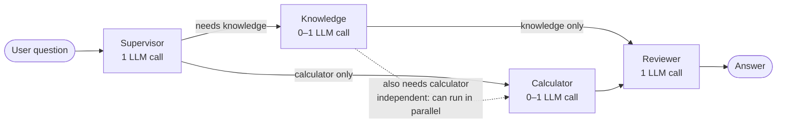

# Stage 2: Multi-Agent Backend (sync version)

[← Back to README](../README.md)

> Work in progress.

## Agent flow

| Step | Depends on | LLM calls |
|---|---|---|
| Supervisor | The user's question | 1 |
| Knowledge | Supervisor's route | 0–1 (0 if no FAQ matches) |
| Calculator | Supervisor's route | 0–1 (0 if the amount or term is missing) |
| Reviewer | All expert results | 1 |

**Knowledge and Calculator don't need each other's results.** In this sync version they still run one after the other, on purpose: that's the baseline.
Stage 4 runs them in parallel and measures how much time that saves for questions that need both.

LLM calls per request:

| Question type | Path | LLM calls |
|---|---|---|
| Knowledge only | Supervisor → Knowledge → Reviewer | 3 |
| Calculator only | Supervisor → Calculator → Reviewer | 3 |
| Both | Supervisor → Knowledge → Calculator → Reviewer | 4 |

With the question pool's 4 : 3 : 3 mix, that's **3.3 LLM calls per user request on average**.

## Shared state

Every node reads one shared state and returns only the fields it changes. See [`state.py`](../backend/agents/state.py).

| Field | Written by | Merge rule | Kept across turns? |
|---|---|---|---|
| `messages` | API (question), Reviewer (answer) | Append (`add_messages`) | ✅ Yes, it's the conversation memory |
| `question` | API | Overwrite | No |
| `route` | Supervisor | Overwrite | No |
| `expert_results` | Knowledge, Calculator | Merge dicts | No, reset each turn |
| `final_answer` | Reviewer | Overwrite | No |
| `steps` | Every node | Append | No, reset each turn |

Each entry in `steps` records the node name, seconds taken, LLM calls, and input/output tokens, so I can see where the time goes.

Two design decisions:

- **`expert_results` and `steps` use merge rules, not overwrite**, even though this version runs one node at a time. In Stage 4, Knowledge and Calculator run at the same time and both write these fields; with overwrite, LangGraph would raise an error.
- **They use a custom merge rule that resets on `None`**, not `operator.add`. With conversation memory, state carries over to the next turn. I tested it: with `operator.add`, turn 2's `steps` still contained turn 1's records (`[a, b, a, b]`). Now the API passes `None` at the start of each turn to clear them.
